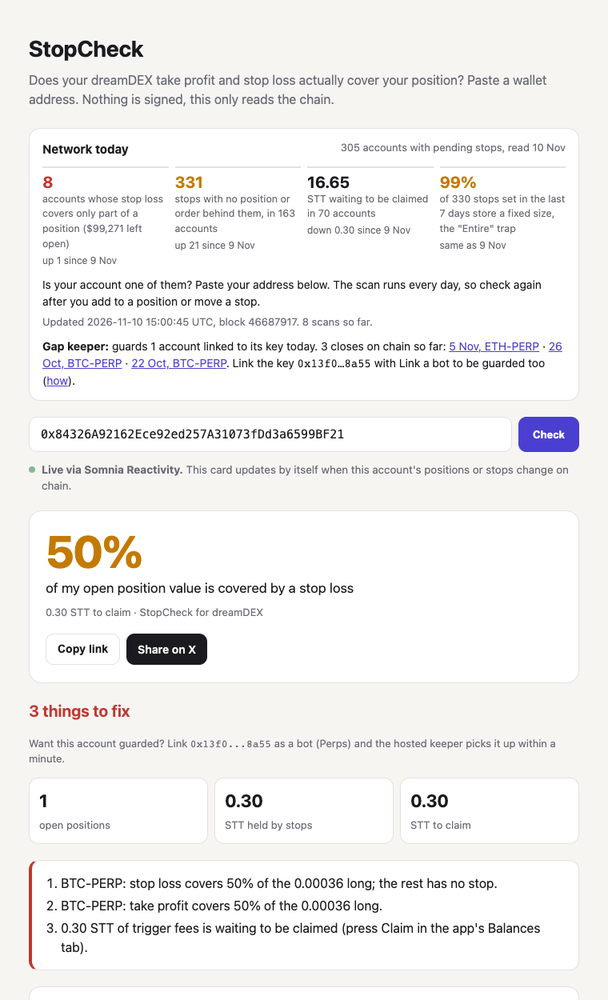
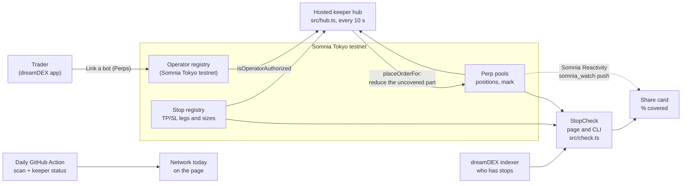

# StopCheck for dreamDEX perps

Your take profit and stop loss on dreamDEX may not cover the position you think they cover. StopCheck tells you, for any account, how much of each position a stop loss really protects. A small bot then closes the unprotected part when your stop price is hit.

It is a safety layer, not a patch for one bug. It compares every stop with the position it protects, so it keeps catching gaps after "Entire" is fixed: stops left armed after a cancelled order, partial take profits, stops with no position behind them. The daily scan would also show such a fix working, as the count of partly covered accounts drops to zero.

We found the trap while testing dreamDEX perps, in one of our 21 feedback reports; this tool is the answer to the one that can cost a trader the most.

**Demo video (104 s, real screens, 5 Nov):** https://youtu.be/aGLra4y-bGE (also in the repo: [demo/stopcheck-demo-v2.mp4](demo/stopcheck-demo-v2.mp4)). Shorter first version: https://youtu.be/T29UDxKIuF8

**Try it:** https://dmitriytopka.github.io/stopcheck/ (paste an address, or open `https://dmitriytopka.github.io/stopcheck/#0xYourAddress`). Nothing is signed; the page only reads Somnia Tokyo testnet.



## Judges start here

- **Live right now.** Open https://dmitriytopka.github.io/stopcheck/#0x84326A92162Ece92ed257A31073fDd3a6599BF21. The card says the stop loss covers 50% of a 0.00036 BTC long: an "Entire" stop set before the position was doubled. Our keeper watches this account on a server until the bounty results are out.
- **It worked six times on chain, on five markets.** Each time the account's own stop closed half and the keeper closed the other half seconds later. 22 Oct: [stop](https://explorer.testnet.somnia.network/tokyo/tx/0x2db1fbb610bcc905796b47326246ea95e5b055c011ca4b907fb9b3f043825178), [keeper](https://explorer.testnet.somnia.network/tokyo/tx/0x8524c1fb944ecc7ceacfcd08087aa940e0acfc5d77f75a1dad7cbff8dc67abc2). 26 Oct: [stop](https://explorer.testnet.somnia.network/tokyo/tx/0x9b13ce9e6fb4175ce030494444014a0afed12984188bf21d8531c4d92eda2aee), [keeper](https://explorer.testnet.somnia.network/tokyo/tx/0x01a5d298b7453fab8e22fe9689f99264ca7af821942c1eb2703c78b2eccbcc12). 5 Nov (ETH): [stop](https://explorer.testnet.somnia.network/tokyo/tx/0x5d01311d4e27c2314b9d1352eec62a11aab8c0b455c9328682d97003528e1db6), [keeper](https://explorer.testnet.somnia.network/tokyo/tx/0x13c80f3832d78e072054647faa87d47be5e528e6a422851fc3cb09422fe28ec3), 18 s later. 10 Nov (SOL): [stop](https://explorer.testnet.somnia.network/tokyo/tx/0x80c5ad3c60c042b2afe91e189ef078c0fe4a12aacd42571cb8f0a67692cdbc99), [keeper](https://explorer.testnet.somnia.network/tokyo/tx/0xca131b59b4f92a4fd72dd18b30c5c2766b086c37538212a59a9b719595893c15), 19 s later. 12 Nov (AVAX): [stop](https://explorer.testnet.somnia.network/tokyo/tx/0xa4ab30ec80e31ade793b18abbe313785048d939944f641f912825ff50dcd55ae), [keeper](https://explorer.testnet.somnia.network/tokyo/tx/0x549a8b8a328602ff85a6c0fc0799f8bf6acb510489d89529202e57471146a94a), 52 s later; this run found a bug in the keeper, fixed the same morning. 12 Nov (LINK), with the fix and the hub woken by Somnia Reactivity: [stop](https://explorer.testnet.somnia.network/tokyo/tx/0xf5cab3ad8f1d8f980f0d5b44a7be2aee9442146f3321d1e10b5e41f196b2dd40), [keeper](https://explorer.testnet.somnia.network/tokyo/tx/0xe5f07b97c9815cc6337b1dad85eec9b33ecc990193cc32d381999fbfae964eb1), 11 s later. Full timelines below.
- **Try it on your own account.** Link our bot key `0x13f05c8e15cC0d7d3abff02C144fb74778018a55` with Link a bot (Perps) and the hosted keeper guards your positions within a minute. See [Protect your own account](#protect-your-own-account).
- **Not just our account.** On 5 Nov we scanned all 453 accounts that had pending stops. 12 had a stop loss covering only part of a position (one of them is our demo account), leaving about $41,300 of position value with no stop. 180 were holding 317 stops with no position or order behind them. Of the 738 stops created in the 7 days before, 713 (97%) store a fixed size, so they stop covering the whole position as soon as it grows. The page shows these numbers and refreshes them every day (on 11 Nov: 6 accounts, about $94,100 of position value with no stop).

| Judging criterion | Where to look |
|---|---|
| Clear user value | [Why](#why), the live card above, the network numbers |
| Repeat-use loop | "Network today" on the [page](https://dmitriytopka.github.io/stopcheck/), refreshed daily by a [GitHub Action](.github/workflows/scan.yml), with the keeper's status under it (accounts guarded, every close with its tx); any trader can re-check an address after each change to a position |
| Technical execution | [How it reads](#how-it-reads) (sizes from the chain, not the indexer), [`src/check.ts`](src/check.ts), [`src/keeper.ts`](src/keeper.ts) with a gas cap |
| Live orders and tx hashes | The [live runs](#live-demo-somnia-tokyo-testnet-2026-10-22) below, keeper logs in [`demo/`](demo) |
| X posts | [X posts](#x-posts) |
| Somnia primitives (a plus) | Off-chain [Somnia Reactivity](#live-card-somnia-reactivity) in two places: the card updates itself when the account changes on chain ([`src/web.ts`](src/web.ts)), and the keeper hub is woken by the same subscription instead of waiting for its next poll ([`src/wake.ts`](src/wake.ts)) |
| Mainnet | [Mainnet](#mainnet) |
- **Video and posts.** 104-second demo of real screens at https://youtu.be/aGLra4y-bGE, five X posts tagging @DreamDEXSomnia at the end of this page.

## Why

While testing dreamDEX perps on Somnia Tokyo testnet (Hideki) for the Perps Builder Bounty, we hit three ways a trader ends up less protected than the app suggests:

1. **"Entire" is not the whole position.** A TP/SL set in Entire mode stores the size the position had at that moment. Add to the position and the app still says Entire, but the stop loss closes only the original part. ([report 019](https://github.com/DmitriyTopka/dreamdex-perps-feedback/blob/main/feedback/019-entire-tpsl-covers-only-the-size-at-creation.md))
2. **Cancelled order, live stops.** TP/SL attached to a limit order stay armed after the order is cancelled. They hold 0.15 STT each and later act on whatever position you open next. ([report 022](https://github.com/DmitriyTopka/dreamdex-perps-feedback/blob/main/feedback/022-cancelling-a-limit-order-leaves-its-tpsl-armed.md))
3. **Fees parked, not refunded.** When one leg of a linked TP/SL fills, the other leg's 0.15 STT is credited to a claimable balance instead of coming back. ([report 020](https://github.com/DmitriyTopka/dreamdex-perps-feedback/blob/main/feedback/020-linked-leg-fee-is-credited-not-refunded-sdk-and-kit-say-refunded.md))

These are not only our test accounts. A scan of accounts with pending stops on 2026-10-22 showed live positions with a stop loss covering 84% of a 0.78 BTC short and a take profit covering 48% of a 2,119 ZRO long.

A fresh scan on 2026-10-26 found the same picture four days later: of 293 accounts with pending stops, 13 have a stop loss that covers only part of a position, 100 hold 134 stops with no position or order behind them, and 27 have 5.12 STT waiting to be claimed. Report 019 still reproduces: of the 205 pending stops created from 23 Oct on, 201 store a fixed size, so an "Entire" stop still stops covering the whole position once you add to it.

On 2026-11-05 the scan covered all 453 accounts with pending stops: 12 partly covered, 180 accounts holding 317 orphan stops, 17.47 STT waiting to be claimed by 73 accounts, and 713 of the 738 stops created in the last 7 days store a fixed size. The latest numbers are always in [`docs/scan-latest.json`](docs/scan-latest.json).

## What it does

- **Check (web page and CLI). Start here.** Paste an address and get a share card with one number: how much of the account's open position value a stop loss covers. Below it: the share of each open position covered by its stop loss and by its take profit; stops with no position, split into "waiting for a resting order" and true orphans; STT held by stops and STT waiting to be claimed.
- **Live card (Somnia Reactivity).** Once an address is open, the page keeps a Reactivity subscription and redraws the card by itself when that account trades or its stops change. See [Live card](#live-card-somnia-reactivity).
- **Gap keeper (bot).** A trading key linked to your account with "Link a bot" cannot arm stops for you; only the account can. So the keeper watches instead: when the mark reaches your stop loss and that stop covers only part of the position, it closes the uncovered rest with a reduce order through `placeOrderFor`.

## Live demo (Somnia Tokyo testnet, 2026-10-22)

The trap from report 019, reproduced in the dreamDEX app and closed by the keeper. Account `0x84326A92162Ece92ed257A31073fDd3a6599BF21`, BTC-PERP, linked bot key `0x13f05c8e15cC0d7d3abff02C144fb74778018a55`.

| time (UTC) | what happened | transaction |
|---|---|---|
| 19:18:57 | Long 0.00018 BTC in the app | [0xfb3f20ae…955ac3](https://explorer.testnet.somnia.network/tokyo/tx/0xfb3f20ae55c32a67a7402112893a4f82ee9f4bb61e61ac2883097ef618955ac3) |
| 19:19 | TP/SL set in **Entire** mode (TP 90,000, SL 81,260): both legs store 0.00018 BTC | |
| 19:21:21 | Added 0.00018 BTC, position now 0.00036. App still says Entire; StopCheck: "stop loss covers 50%" | [0xda18d4a5…62e8d9](https://explorer.testnet.somnia.network/tokyo/tx/0xda18d4a5b124ad3858ddf5ec39a81064b1fa327532045eb5b31b0001d562e8d9) |
| 19:31:45 | Stop loss moved to 81,385 in the app. The new leg is again 0.00018 BTC, so editing does not fix it | |
| 19:34:35 | Mark crosses 81,385, the stop registry fires the account's own stop loss: closes 0.00018 | [0x2db1fbb6…825178](https://explorer.testnet.somnia.network/tokyo/tx/0x2db1fbb610bcc905796b47326246ea95e5b055c011ca4b907fb9b3f043825178) |
| **19:34:38** | **Gap keeper closes the other 0.00018 with `placeOrderFor` from the linked bot key** | [0x8524c1fb…67abc2](https://explorer.testnet.somnia.network/tokyo/tx/0x8524c1fb944ecc7ceacfcd08087aa940e0acfc5d77f75a1dad7cbff8dc67abc2) |

Without the keeper, half of the position would have stayed open with no stop after the trader's stop loss "fired on the entire position". Keeper log: [`demo/keeper-2026-10-22.log`](demo/keeper-2026-10-22.log). Gas spent by the bot for the whole run: 0.0098 STT.

## Second live run (2026-10-26)

The same trap, four days later, right after the fresh scan.

| time (UTC) | what happened | transaction |
|---|---|---|
| 06:17:18 | Long 0.00018 BTC in the app | [0xed50ea61…95ccc7f3](https://explorer.testnet.somnia.network/tokyo/tx/0xed50ea6153c924f13587abe4ccecf3d8b83c2382353583418553d8ca95ccc7f3) |
| 06:18:07 | TP/SL in **Entire** mode (TP 90,000, SL 79,900): both legs store 0.00018 BTC | [0x04f15186…cafe8f7fce](https://explorer.testnet.somnia.network/tokyo/tx/0x04f151862f4943a39e879989ee50f7608d97e9f97e9d07b8161934cafe8f7fce) |
| 06:18:35 | Added 0.00018 BTC, position 0.00036. StopCheck: "stop loss covers 50%" | [0x905f1043…2ba3127d](https://explorer.testnet.somnia.network/tokyo/tx/0x905f1043f9dcdcb58b6492a6076a9a10af6cfcc557666450e93e66cb2ba3127d) |
| 06:27:00 | The account's own stop loss fires and closes 0.00018 | [0x9b13ce9e…2eda2aee](https://explorer.testnet.somnia.network/tokyo/tx/0x9b13ce9e6fb4175ce030494444014a0afed12984188bf21d8531c4d92eda2aee) |
| **06:27:15** | **Gap keeper closes the other 0.00018 with `placeOrderFor` from the linked bot key** | [0x01a5d298…eccbcc12](https://explorer.testnet.somnia.network/tokyo/tx/0x01a5d298b7453fab8e22fe9689f99264ca7af821942c1eb2703c78b2eccbcc12) |

Gas spent by the bot: 0.0098 STT. Keeper log: [`demo/keeper-2026-10-26.log`](demo/keeper-2026-10-26.log). After the run the app showed its own banner for the other leg's 0.15 STT ("held for you to claim rather than refunded"), the case from report 020.

## Third live run (2026-11-05, ETH-PERP)

A different market, ten days after the second run, with the BTC demo position left untouched. The keeper picked up the new position by itself.

| time (UTC) | what happened | transaction |
|---|---|---|
| 09:17:45 | Long 0.0061 ETH in the app | [0xa3b785de…f9c71b](https://explorer.testnet.somnia.network/tokyo/tx/0xa3b785de988cf2230e077343489531f4020635cc9c00ad0fdc184227b7f9c71b) |
| 09:18:13 | TP/SL in **Entire** mode (TP 2,600, SL 2,300): both legs store 0.0061 ETH | [0x64fe1073…05d308](https://explorer.testnet.somnia.network/tokyo/tx/0x64fe1073b8244a11040bee04c3df468baf3d0e515d7b1bd3ca34138c8c05d308) |
| 09:18:34 | Added 0.0061 ETH, position 0.0122. The dialog still says Entire and estimates the loss on half the position (-0.68 USDso). StopCheck and the keeper log: "stop covers 50.0%" | [0xdce25a28…4dbb8a](https://explorer.testnet.somnia.network/tokyo/tx/0xdce25a28ec0111f796bbc9cc1189ecd44816d7c7b7b755f670ed17d9c94dbb8a) |
| 09:19:27 | Stop loss moved to 2,410.5 in the app. The new leg again stores 0.0061 ETH | [0xb7ae9e87…252c65](https://explorer.testnet.somnia.network/tokyo/tx/0xb7ae9e8788789532571070b9f2ec04a4a55625e63778f13d0041de0b4f252c65) |
| 09:23:45 | The account's own stop loss fires and closes 0.0061 | [0x5d01311d…8e1db6](https://explorer.testnet.somnia.network/tokyo/tx/0x5d01311d4e27c2314b9d1352eec62a11aab8c0b455c9328682d97003528e1db6) |
| **09:24:03** | **Gap keeper closes the other 0.0061 with `placeOrderFor` from the linked bot key** | [0x13c80f38…e28ec3](https://explorer.testnet.somnia.network/tokyo/tx/0x13c80f3832d78e072054647faa87d47be5e528e6a422851fc3cb09422fe28ec3) |

Gas spent by the bot: 0.0099 STT. Keeper log lines for this run: [`demo/keeper-2026-11-05-eth.log`](demo/keeper-2026-11-05-eth.log).

## Fourth live run (2026-11-10, SOL-PERP)

A third market, five days after the ETH run. Nothing was set up for the keeper by hand: the hosted hub already guards the demo account, so it picked up the new SOL position within seconds and logged "stop covers 50.0%".

| time (UTC) | what happened | transaction |
|---|---|---|
| 18:34:45 | Long 0.18 SOL in the app | [0x9d9c8c1d…87ada7](https://explorer.testnet.somnia.network/tokyo/tx/0x9d9c8c1d18a688894780a98e652529aa149d34a9695bbb3ba3766c573d87ada7) |
| 18:35:19 | TP/SL in **Entire** mode (TP 90, SL 80): both legs store 0.18 SOL | [0x33ffea5b…6cebcc](https://explorer.testnet.somnia.network/tokyo/tx/0x33ffea5b619b5cd9ac64dd0321554077a490a8a186a54be770d3fe07166cebcc) |
| 18:35:40 | Added 0.18 SOL, position 0.36. The dialog still says Entire and estimates the loss on half the position. The hub log: "stop covers 50.0%, 0.18 uncovered" | [0x6bc66388…fa8c73](https://explorer.testnet.somnia.network/tokyo/tx/0x6bc66388db1ae63ce1e048fafa2480029fc36293aaeba5e6a905c27b3efa8c73) |
| 18:36:17 | Stop loss moved to 82.70 in the app. The new leg again stores 0.18 SOL | [0x46eb9630…7d3cd1](https://explorer.testnet.somnia.network/tokyo/tx/0x46eb96307f72cd66c7a48f54cceaef4b9ecbbdac217798c42becec8c737d3cd1) |
| 19:06:40 | The account's own stop loss fires and closes 0.18 | [0x80c5ad3c…cdbc99](https://explorer.testnet.somnia.network/tokyo/tx/0x80c5ad3c60c042b2afe91e189ef078c0fe4a12aacd42571cb8f0a67692cdbc99) |
| **19:06:59** | **Hosted keeper hub closes the other 0.18 with `placeOrderFor` from the linked bot key** | [0xca131b59…893c15](https://explorer.testnet.somnia.network/tokyo/tx/0xca131b59b4f92a4fd72dd18b30c5c2766b086c37538212a59a9b719595893c15) |

Gas spent by the bot: 0.0047 STT. Hub log lines for SOL: [`demo/keeper-2026-11-10-sol.log`](demo/keeper-2026-11-10-sol.log). At the time the hub only polled, every 10 s. Since 12 Nov it is also woken by Somnia Reactivity; see the sixth run.

**Live for judging.** Account `0x84326A92162Ece92ed257A31073fDd3a6599BF21` holds the trap right now: a 0.00036 BTC long whose Entire stop loss at 70,000 covers 0.00018. Open https://dmitriytopka.github.io/stopcheck/#0x84326A92162Ece92ed257A31073fDd3a6599BF21 and the card says 50%. The gap keeper watches this account on our server until the bounty results are announced. It stops by itself after spending 1 STT of gas (`KEEPER_GAS_CAP_STT`).

## Fifth live run (2026-11-12, AVAX-PERP): the run that found a bug

Same setup on a fourth market: long 3.4 AVAX, an Entire stop loss that covers 1.7 after the position was doubled.

| time (UTC) | what happened | transaction |
|---|---|---|
| 09:00:50 | The account's own stop loss fires and closes 1.7 | [0xa4ab30ec…cd55ae](https://explorer.testnet.somnia.network/tokyo/tx/0xa4ab30ec80e31ade793b18abbe313785048d939944f641f912825ff50dcd55ae) |
| **09:01:42** | **The hub closes the other 1.7, 52 s later** | [0x549a8b8a…46a94a](https://explorer.testnet.somnia.network/tokyo/tx/0x549a8b8a328602ff85a6c0fc0799f8bf6acb510489d89529202e57471146a94a) |

52 s is too slow, and the log says why. The hub saw the mark cross the stop and worked out "close 50%" from the size it had read a moment before, 3.4. By the time the order was built the stop had already closed half, so 50% of what was left was 0.85 AVAX, under the market minimum of 1.4. The close was skipped and the hub waited out its 30 s cooldown:

```
AVAX-PERP long 3.4: stop covers 50.0%, 1.70000 uncovered | SL 8.585 | HIT
close skipped: 50% of 1.7 AVAX is below the market minimum of 1.4.
AVAX-PERP long 1.7: stop covers 0.0%, 1.70000 uncovered | STOP FIRED
placed gap keeper short 1.7 AVAX @ 8.556 | filled 1.7
```

The fix in [`src/gap.ts`](src/gap.ts): right before a close the keeper reads the live size again and closes `min(1, uncovered / live size)` of it, and a skipped close no longer starts the cooldown. Logs: [`demo/keeper-2026-11-12-avax.log`](demo/keeper-2026-11-12-avax.log).

## Sixth live run (2026-11-12, LINK-PERP): with the fix and Reactivity

The fixed hub went live at about 09:05 UTC, now also subscribed with Somnia Reactivity (`somnia_watch`, off-chain, free) to all 75 perp pools, margin banks and stop registries. Long 2.9 LINK, Entire TP/SL, then 2.9 more, then the stop loss moved to 10.03.

| time (UTC) | what happened | transaction |
|---|---|---|
| 11:17:00 | The account's own stop loss fires and closes 2.9 | [0xf5cab3ad…b2dd40](https://explorer.testnet.somnia.network/tokyo/tx/0xf5cab3ad8f1d8f980f0d5b44a7be2aee9442146f3321d1e10b5e41f196b2dd40) |
| 11:17:00.3 | The Reactivity event for the account reaches the hub | hub log |
| **11:17:11** | **The hub closes the other 2.9, 11 s after the stop** | [0xe5f07b97…964eb1](https://explorer.testnet.somnia.network/tokyo/tx/0xe5f07b97c9815cc6337b1dad85eec9b33ecc990193cc32d381999fbfae964eb1) |

11 s against 18 and 19 s on the earlier runs and 52 s on AVAX. Gas spent by the bot on this account so far: 0.0243 STT. Log: [`demo/keeper-2026-11-12-link.log`](demo/keeper-2026-11-12-link.log).

## Protect your own account

The keeper is hosted. You do not run anything: link our bot key to your account and it is guarded within a minute.

1. In the dreamDEX app open your wallet and choose **Link a bot** (the same step the official bot kit README describes), tick **Perps** and paste `0x13f05c8e15cC0d7d3abff02C144fb74778018a55`.
2. That is all. Every minute the hosted keeper looks for accounts that linked this key, asks each perp pool whether the link is real (`isOperatorAuthorized`), and from then on checks your positions every 10 seconds. You can watch the result on the [page](https://dmitriytopka.github.io/stopcheck/) with your address.

What it will do: when a position's stop loss covers only part of it and the mark crosses that stop (or the stop fires), it closes the part the stop left open with a reduce order from the bot key. Never more than that part, never more than what is still open.

What it will not do: open positions, add to them, move or cancel your stops, touch a position whose stop already covers all of it, or act on a position with no stop loss at all. The key cannot withdraw: a linked bot only places, cancels and reduces orders for your account, and pays its own gas. If you cancel your stop loss yourself, the keeper leaves that position alone.

Testnet only. This runs on Somnia Tokyo testnet (Hideki) for the dreamDEX bounty. There are no perp markets on mainnet yet.

To stop it, remove the bot in the same Link a bot panel (or call `setOperatorApprovalForPool(pool, 0x13f0...8a55, selectors, false)` on the registry from your wallet). The pool then says no, the keeper drops your account at its next refresh, and before every close it asks the pool again anyway.

## Next

The hosted keeper above serves every account that links its key ([`src/hub.ts`](src/hub.ts)). What is left:

- A Telegram or email note to the trader when the keeper closes a gap, with the tx link.
- Mainnet, as below, once perps launch there.

## Mainnet

Somnia mainnet has no perp markets yet, and the bot kit refuses `NETWORK=mainnet` for that reason. Nothing in the keeper's logic is testnet-specific: it reads positions and stops from the chain and closes with `placeOrderFor`. When perps go live, three things change:

1. `src/check.ts` takes the chain, indexer and address preset from `NETWORK` instead of the Hideki constants (lines 14-17 and 73).
2. The keeper runs on the kit's mainnet branch of perp-core once the kit ships one, with `KEEPER_RPC` pointed at the mainnet RPC. The stop registry address is read from the pool with `getOperatorPermissionsRegistry(pool)`, so no hardcoded address is needed.
3. The trader links the keeper key with Link a bot on mainnet and puts some SOMI on it for gas. Each testnet run cost the bot 0.0098 STT, and the 1-token gas cap stays.

Our plan is to switch the demo keeper to mainnet within the 30 days after perps launch there.

## Who it is for

Anyone trading perps on dreamDEX who sets TP/SL and then adds to or trims a position, and bot builders who arm brackets through the Markets SDK.

StopCheck does not trade for you, and that is the difference from DreamFly, the official dreamBot released on 3 Nov. DreamFly decides which strategy to run and when to sit out, and guards its own trades with a daily loss stop. StopCheck is for positions you opened yourself in the app: it checks what your TP/SL on the stop registry really covers and closes only the part your stop loss left open. The two can run side by side.

## Run it

```bash
npm install
npm run check -- 0xYourAddress     # one account
npm run check -- --scan 100        # accounts with pending stops
npm run check -- --scan 500 --json docs/scan-latest.json --history docs/scan-history.json   # network numbers for the page, no addresses
npm run build:web                  # rebuilds docs/app.js for the page
```

Node 20+. Reads go to the public Hideki RPC and indexer; no keys are needed for the check.

### Gap keeper

The keeper reuses the official [dreamdex-bot-kit](https://github.com/somnia-chain/dreamdex-bot-kit) (`@dreamdex-bot-kit/perp-core`) for the linked trading key and the reduce order. Clone the kit, run `npm install` there, then link its perp-core into this repo:

```bash
mkdir -p node_modules/@dreamdex-bot-kit
ln -s /path/to/dreamdex-bot-kit/packages/perp-core node_modules/@dreamdex-bot-kit/perp-core
PRIVATE_KEY=0x... OWNER_ADDRESS=0xYourAccount NETWORK=hideki npm run keeper              # dry run, logs only
PRIVATE_KEY=0x... OWNER_ADDRESS=0xYourAccount NETWORK=hideki DRY_RUN=false npm run keeper
```

`PRIVATE_KEY` is the bot key you linked in the app with Link a bot (Perps), not your wallet key. Every 10 seconds the keeper re-reads the account. For a position whose stop loss covers only part of it, it remembers the uncovered size and the first stop-loss trigger. When the mark crosses that trigger it re-reads the position and closes the uncovered size, capped at what is still open, so it never closes more than your stop left behind. Code: [`src/keeper.ts`](src/keeper.ts).

The hosted version guards every account that linked the key, with the same per-account logic ([`src/gap.ts`](src/gap.ts)):

```bash
npm run owners                                   # who linked 0x13f0...8a55, checked on chain
npm run hub                                      # dry run, no key needed
PRIVATE_KEY=0x... DRY_RUN=false npm run hub      # live
```

Owners come from the indexer's `OperatorApproval` rows for the bot key plus the registry's own logs since start, and each one is confirmed with `isOperatorAuthorized(owner, bot, placeOrderFor)` on every perp pool. The list refreshes every 60 s (`HUB_REFRESH_MS`). Before each live close the hub asks the pool again, and it stops sending for one account after `HUB_OWNER_GAS_CAP_STT` (0.1) and for all after `KEEPER_GAS_CAP_STT` (1) STT, while still watching and logging. One account failing never stops the others. Code: [`src/hub.ts`](src/hub.ts), [`src/owners.ts`](src/owners.ts).

## How it reads



Sizes are always read from the chain; the indexer only says where to look.

### Live card (Somnia Reactivity)

After the first read, the page opens an off-chain Reactivity subscription (`somnia_watch` over `wss://api.hideki2.infra.testnet.somnia.network/ws`) for every perp pool, margin bank and stop registry. The node pushes each log as it lands in a block. When a log names the account (in its topics or data), the page reads the account again from the chain and redraws the card, at most once every 5 seconds. Off-chain subscriptions cost nothing, need no key and sign nothing. Code: `watchLive` in [`src/web.ts`](src/web.ts).

Market list, pending stops and candidate positions come from the dreamDEX indexer. Position sizes (`getPerpPosition`), stop sizes and links (`getPerpStopOrders`), resting orders (`getOpenOrdersOnchain`) and claimable fees (`getUnclaimedPerpStopSomi`) are read from the chain, so a lagging indexer cannot make a position look covered. Code: [`src/check.ts`](src/check.ts).

## X posts

1. [The "Entire" trap and the bot that closed the other half (with the demo video)](https://x.com/SirenaMC2/status/2113498955908812882)
2. [463 accounts scanned: 19 with a stop loss covering only part of the position](https://x.com/SirenaMC2/status/2113499393676488753)
3. [Cancelled limit orders leave their TP/SL armed](https://x.com/SirenaMC2/status/2113499520369910070)
4. [Third live run, on ETH: the keeper closed the uncovered half 18 s after the stop (with the new video)](https://x.com/SirenaMC2/status/2118283633450508554)
5. [All 453 accounts with pending stops: 12 partly covered, 713 of 738 new stops fixed-size](https://x.com/SirenaMC2/status/2118284098107998236)

All five tag @DreamDEXSomnia: 1-3 posted on 2026-10-23, 4-5 on 2026-11-05.

## Known limitations

- Testnet only. There are no perp markets on Somnia mainnet yet; see [Mainnet](#mainnet).
- The keeper guards only accounts that link its key. Today that is one account, our demo account; the page shows the current count every day ([`src/status.ts`](src/status.ts)).
- It needs a stop loss to act on. A position with no stop loss, or one whose stop already covers all of it, is left alone.
- The list of accounts to scan comes from the dreamDEX indexer. Sizes are read from the chain, but an account the indexer has not seen yet is not in the daily numbers.
- The keeper closes at market with a reduce order after the mark crosses the stop, so the fill can differ from the stop price, as with any stop.
- The live card works only while the page is open; if the socket drops, it says so and stops updating. The keeper hub is woken by Reactivity too, and still polls every 10 seconds as a fallback if the socket drops.
- Six live closes so far, all on our own test account. We have not seen it run on someone else's position.

## How this was built

Written during the bounty, from 22 Oct, by one person with Claude Code (Anthropic) as the coding assistant: it wrote most of the code, the scripts and the texts. The trades in the live runs were placed in the dreamDEX app on our test account and every close was checked on the explorer. Every number on this page comes from a script in this repo, with its output saved in [`demo/`](demo) or [`docs/`](docs).

## License

MIT
